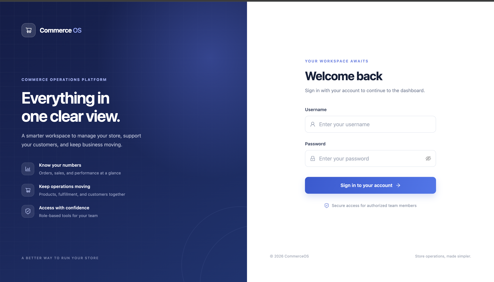
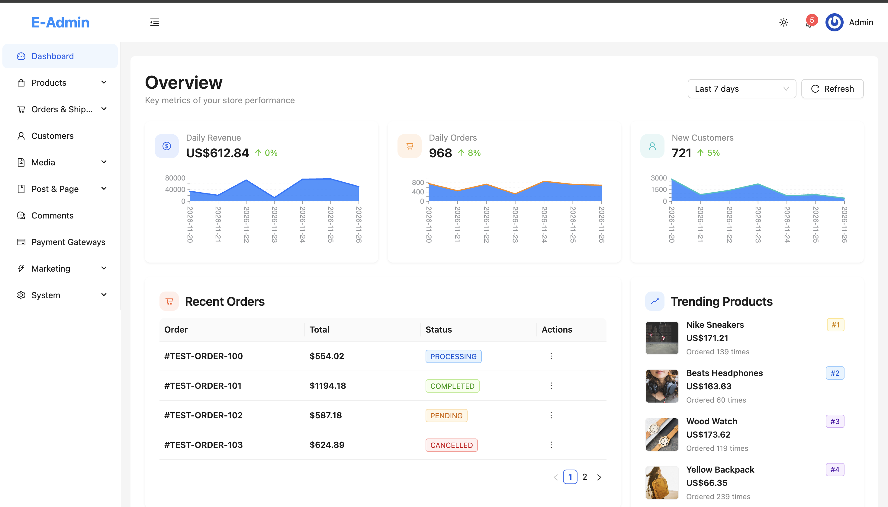
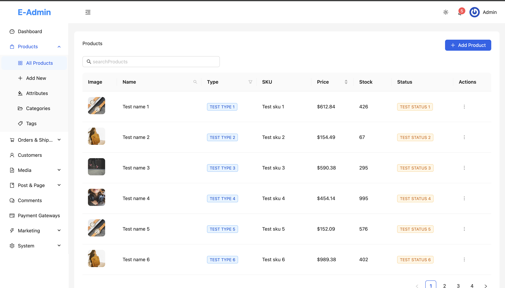
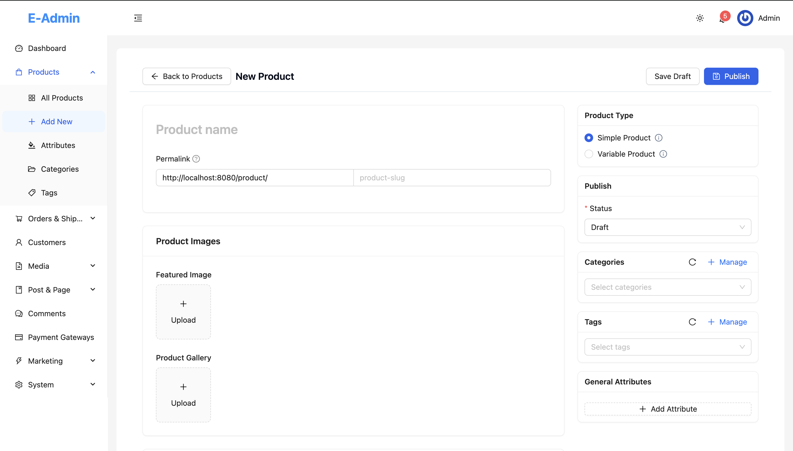
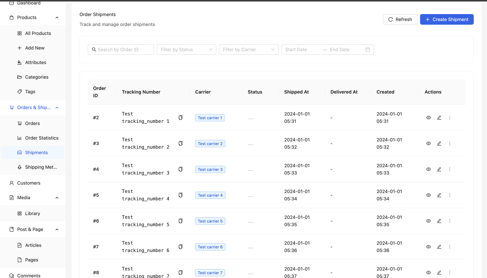
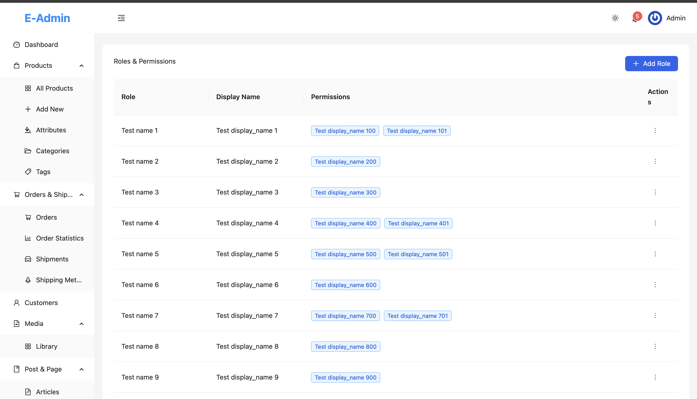

# Commerce OS

A mock-first e-commerce operations dashboard for managing products, orders, customers, content, and administration.

**Project owner:** Shridhar Kumar

> **Project status:** The backend is not ready and the application is not hosted yet. The frontend currently uses mock data and API responses through Mock Service Worker (MSW). No live business data is connected.

## Screenshots

| Login | Dashboard |
| --- | --- |
|  |  |

| Products | Product editor |
| --- | --- |
|  |  |

| Order shipments | Permissions |
| --- | --- |
|  |  |

## About

Commerce OS is an administrative dashboard prototype built with React and TypeScript. It provides a shared interface for common e-commerce operations, with role-aware navigation and light/dark themes.

All current API interactions are simulated by MSW. The app is intended for local UI development and demonstration; login, records, and workflows do not connect to a production backend.

## Features

- Dashboard with overview metrics, charts, and recent orders
- Product catalog, categories, tags, and product editor
- Orders, shipments, and shipping methods
- Customer management
- Coupons, posts, pages, comments, and media library
- Payment gateway configuration screens
- Roles, permissions, and administration pages
- Responsive layout with light and dark themes

## Technology

- React 18, TypeScript, and Vite
- Ant Design, shadcn/ui, Radix UI, and Tailwind CSS
- React Router and TanStack React Query
- Axios for API requests
- Mock Service Worker (MSW) for mock API responses
- React Hook Form and Zod for forms and validation
- Recharts and Ant Design Plots for charts

## Run locally

### Requirements

- Node.js 18 or newer
- pnpm

### Install and start

From the project directory:

```bash
pnpm install
cp .env.example .env
```

In `.env`, set `VITE_USE_MOCKS=true`. The example environment file may have mocks disabled, so make this change before starting the app.

```bash
pnpm dev
```

Open the local development address shown by Vite (by default, `http://localhost:8080`). This is a local address, not a hosted website.

### Mock login

Mock authentication is for UI testing only:

- Enter `admin` as the username to use the Admin role.
- Enter another username to use the Editor role.
- The mock does not validate the password.

Do not use these mock flows as real authentication or for security testing.

## Mock data configuration

MSW provides the mock API responses and generated sample records. The app does not require a backend server to run when mocks are enabled.

| Variable | Example | Purpose |
| --- | --- | --- |
| `VITE_USE_MOCKS` | `true` | Enable the MSW mock API |
| `VITE_MOCK_SEED` | `1` | Set a repeatable mock-data seed |
| `VITE_MOCK_COUNT` | `20` | Set the generated mock dataset size |
| `VITE_MOCK_AUTH` | `relaxed` | Select `relaxed` or `strict` mock-auth mode |
| `VITE_MOCK_ERROR_RATE` | `0` | Configure simulated request error rate |
| `VITE_MOCK_NOT_FOUND` | `true` | Enable simulated not-found responses |

The backend API and Swagger URLs in the example environment are placeholders for a future integration; no backend is currently available.

## Useful commands

| Command | Description |
| --- | --- |
| `pnpm dev` | Start the local development server |
| `pnpm build` | Create a production build |
| `pnpm build:dev` | Create a development-mode build |
| `pnpm preview` | Preview a production build locally |
| `pnpm lint` | Run ESLint |
| `pnpm type-check` | Run the TypeScript type check |
| `pnpm generate-mocks` | Generate mock data from the OpenAPI specification |

## Project structure

```text
commerce-os/
├── public/
│   └── screenshots/       # README and product screenshots
├── src/
│   ├── components/        # Shared and feature UI components
│   ├── hooks/             # Reusable React hooks
│   ├── layouts/           # Application layouts
│   ├── mocks/             # MSW setup, handlers, and mock data
│   ├── pages/             # Application pages
│   ├── providers/         # Theme and UI providers
│   ├── types/             # Shared TypeScript types
│   └── main.tsx           # Application entry point
├── docs/                  # OpenAPI specification
└── scripts/               # Project utility scripts
```

## License

No license has been specified for this project.
